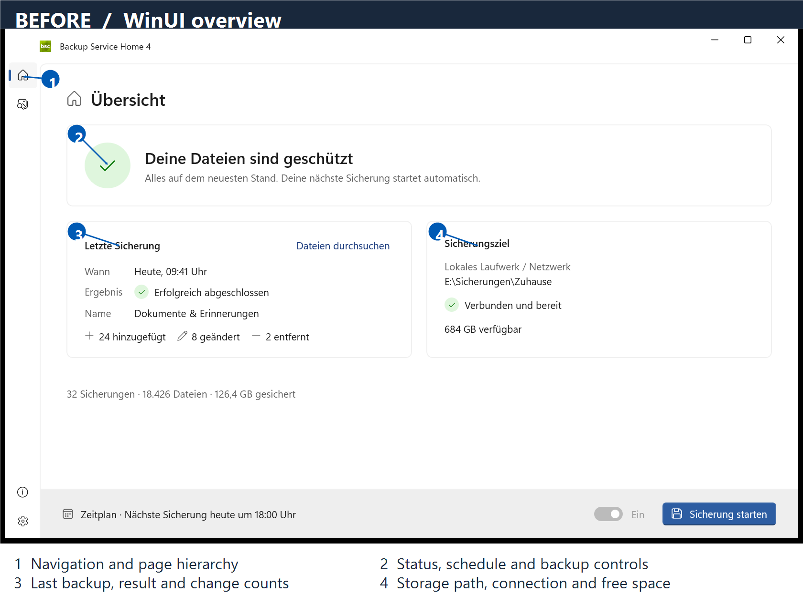
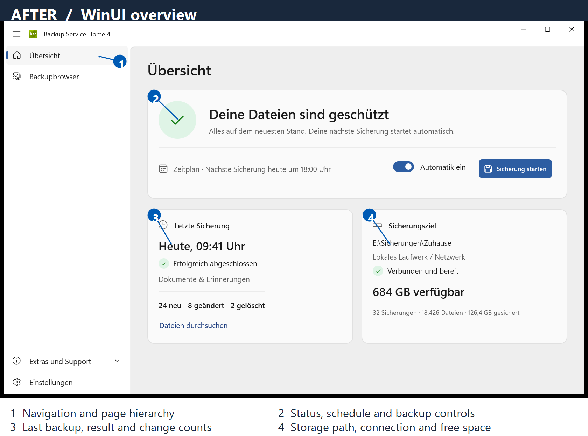

# WinUI overview refresh

The overview now puts status and backup controls together, gives the last backup
and storage details a clear reading order, and uses quiet Fluent surfaces. Wide
windows show navigation labels; smaller windows use compact navigation. Detail
cards stay side by side down to 680 effective pixels, then stack. Light, dark,
and high-contrast colors use theme resources, with dedicated green success tints.

## Before and after

The numbered screenshots below point to the changed areas. Both use the same
deterministic sample data and window size, captured from the real WinUI app.

| Before | After |
| --- | --- |
|  |  |

1. **Navigation and hierarchy:** visible navigation labels at desktop widths,
   a clear page heading with redundant labels removed.
2. **Status and actions:** status gets a clear visual lead; the schedule, system
   toggle and primary backup command move next to it. Warnings put their corrective
   action first; live progress, file counts and cancel stay inside the status card.
3. **Backup details:** the backup time and result lead; change counts are quieter
   with stronger, closely grouped change counts and a dedicated browse link.
4. **Storage:** the path and available space are easier to find; secondary labels
   step back. Lifetime totals live in the storage card with comfortable padding.

## Screenshot set

- [Light before](before-light.png) / [light after](after-light.png)
- [Dark before](before-dark.png) / [dark after](after-dark.png)
- [Narrow window](after-narrow.png)
- [Files skipped warning](after-warning.png)
- [Backup running](after-running.png)

## Reproduce locally

From `src`, build the unpackaged Debug app. Bundling the Windows App SDK avoids
needing a matching machine-wide runtime installation:

```powershell
dotnet build BSH.MainApp/BSH.MainApp.csproj -p:Platform=x64 -p:WindowsAppSDKSelfContained=true -p:OutDir=D:\Git\bsh3\src\artifacts\overview-redesign\bin\
```

Launch that output's `BSH.MainApp.exe --overview-preview`. Add `--dark`,
`--narrow`, `--warning`, or `--running` for the other fixtures. Preview mode is
compiled only in Debug. It bypasses database opening, scheduler startup, tray
initialization, update checks and notification registration. Its log goes to
`%TEMP%\BSH.OverviewPreview`. Pointer and keyboard input are blocked in the
preview; the displayed data is synthetic and no backup runs.

Use `tools/Capture-Overview.ps1 -ProcessId <pid> -OutputPath <path.png>` from the
repository root. It captures only the app window at physical pixel resolution.
The images were captured at 150% Windows scaling, 1680 × 1080 physical pixels;
the narrow fixture uses 1060 × 1080. Normal application startup is unchanged.

## Council review

The named reviewers inspected the real screenshots independently. Sol runs through
Codex; Grok and Opus run through Cursor. All use high effort. The review prompts
do not include a target score. [Round 1 screenshots](round-1/) are preserved.

| Reviewer | Round 1 | Round 2 |
| --- | --- | --- |
| GPT-6.1 Sol | 8/10 | pending |
| Grok 4.7 | 7/10 | pending |
| Opus 5.5 | 6.5/10 | pending |

The second pass consolidates progress and warning actions in the status card,
keeps storage visible in the reviewed narrow window, simplifies typography,
strengthens the change counts, and cleans up the dark success tint. Round 2 is
the final review under the requested two-round limit.
